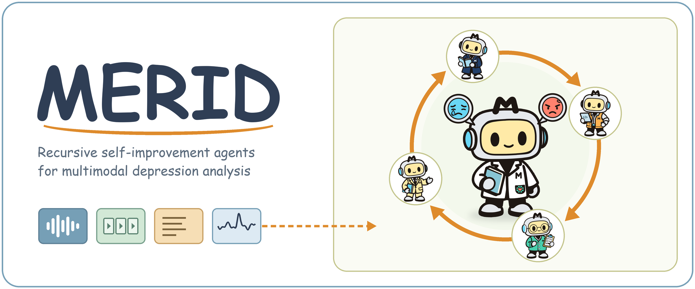

**MERID: Multimodal Exploration via Recursive Self-Improvement Agents for Major Depression Analysis**

MERID builds multimodal depression-detection pipelines through an experience-driven recursive
self-improvement (RSI) loop. Each round proposes pipeline modifications, verifies them under a fixed
development protocol, and carries the verified pipeline and the accumulated experience into the
next round.

## Highlights

- **Grounded State Construction (GSC).** The agent derives a data adapter for each corpus and
  verifies it with execution checks and recipe probes, so every feature recipe sees the same
  subjects, records and targets.
- **Coupled Pipeline Exploration (CPE).** Representation, fusion and predictor choices are searched
  jointly as complete pipelines under one shared development protocol.
- **Evidence-Guided Evolution (EGE).** Planner, Engineer and Reviewer agents analyze the measured
  outcomes, the Chair turns their reports into revision requests, and a revision is inherited when
  its gain exceeds a subject-bootstrap margin.

## How it works

| Step | What happens | Code |
|---|---|---|
| 1. Inspect | The agent profiles the corpus: files, modalities, subjects and label provenance. | `adapter_agent.inspect_dataset`, `label_provenance.py` |
| 2. Propose | The LLM proposes the feature-recipe space, the predictor space and, where the benchmark fixes none, the metric. | `run_method.py`, `run_corpus.py`, `retrieval.py`, `operation.py` |
| 3. Ground (GSC) | The agent writes the data adapter; execution checks and recipe probes verify it, and failed checks trigger repair. | `AdapterAgent.create_adapter` |
| 4. Explore (CPE) | Recipe × predictor pairs are scored on fixed subject-disjoint folds or the official development split. | `DevelopmentSearch.evaluate` |
| 5. Evolve (EGE) | The review roles report to the Chair, who decides ACCEPT or REVISE. Revisions are scored and retained past the bootstrap margin, and the research memory is updated. | `retrospective.hold_review`, `development_search.py`, `research_memory.py` |
| 6. Inherit | The retained pipeline, candidate space, history and memory carry into the next round. | `development_agent.run_development` |
| 7. Test once | The development-selected deployment is scored once on the held-out test set. | `corpus_final_eval.py`, `mpdd2025_final_eval.py`, `mpdd2026_final_eval.py` |

MPDD-2026 runs the search-and-review loop over its binary/PHQ and hierarchical ternary head
families (`run_agent.py`, `mpdd2026_joint_search.py`).

## Repository structure

```
.
├── README.md
├── requirements.txt
├── assets/
│   └── merid_banner.png
└── merid/              MERID source code, grouped by component below
```

| Component | Modules |
|---|---|
| Entry points | `run_corpus.py` (E-DAIC, Mental Health, Kaggle) · `run_method.py` (MPDD-2025) · `run_agent.py` (MPDD-2026) |
| GSC | `adapter_agent.py` · `adapter_source_evidence.py` · `adapter_cache.py` · `label_provenance.py` · `profiler.py` |
| CPE | `development_search.py` · `registry.py` · `operation.py` · `retrieval.py` · `mpdd2025_decoding.py` · `mpdd2025_model_bridge.py` |
| CPE for MPDD-2026 | `space.py` · `manager.py` · `evaluate.py` · `mpdd2026_joint_search.py` · `mpdd2026_data.py` · `mpdd2026_heads.py` · `mpdd2026_protocol.py` · `mpdd2026_metrics.py` |
| EGE | `retrospective.py` · `development_diagnostics.py` · `reliability.py` · `research_memory.py` · `development_agent.py` |
| MPDD-2025 support | `mpdd2025_development_entry.py` · `mpdd2025_corpus_facade.py` · `run_mpdd2025_all.py` · `run_adapter.py` |
| Final evaluation | `corpus_final_eval.py` · `mpdd2025_final_eval.py` · `mpdd2026_final_eval.py` · `run_e2e.py` |
| LLM and logging | `proposer.py` · `trajectory.py` · `progress.py` |

Each module opens with a one-line summary of its role.

## Prompts

The prompts reproduced in the appendix are defined in these modules:

| Prompt | Definition |
|---|---|
| Benchmark metric | `run_method.py` `EVAL_METRIC_SYSTEM` |
| Feature-recipe space | `run_corpus.py` `RECIPE_SYSTEM`; `run_method.py` `RECIPE_SPACE_SYSTEM` |
| Classifier and regressor spaces | `run_method.py` `CLF_SPACE_SYSTEM`, `REG_SPACE_SYSTEM` |
| Model-code generation | `run_method.py` `CODEGEN_SYSTEM` |
| Data adapter derivation and repair | `adapter_agent.py` `ADAPTER_SYSTEM` |
| Method selection | `registry.py` `select_method` |
| MPDD-2026 head proposer | `mpdd2026_joint_search.py` `HeadProposer.propose` |
| Planner, Engineer, Reviewer, Chair | `retrospective.py` `ROLE_SYSTEM`, `CHAIR_SYSTEM`, `REVISION_REQUIRED`, `_INVESTIGATE` |
| Distill and Reconcile | `research_memory.py` `DISTILL_SYSTEM`, `RECONCILE_SYSTEM` |
| Web-search clause | `retrieval.py` `OPTIONAL_SEARCH_CLAUSE` |

## Design principles

- **Selection stays on development data.** Development runs use training data or the official
  development split, review evidence is checked for test fields, and the held-out test set is read
  once, after selection.
- **Subject-level evaluation.** Folds and bootstrap resampling group records by subject, so no
  subject appears on both sides of a split.
- **Traceable runs.** Every run saves its trajectory: system prompts, logged decisions with their
  reasoning, and token and cost totals over all LLM calls.

## Notes

- The API key is read from the `ANTHROPIC_API_KEY` environment variable.
- Paths specific to our computing environment are replaced by placeholders such as `<SPLIT_ROOT>`.
- `requirements.txt` lists the Python packages the modules import.
